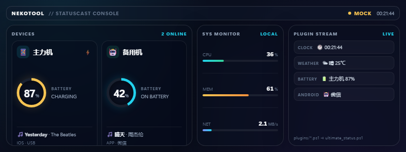

# NekoTool

**StatusCast 专属的桌面聚合工具箱。**

NekoTool 不负责 USB 采集。它只做一件事：把 **StatusCast** 已经整理好的手机状态，和 Windows 的 CPU、内存、网速、时间缝合在一起，然后输出给 NekoTrak、OBS 或其他桌面挂件。

> 底层采集由 [StatusCast](https://github.com/ganmayou2333/StatusCast) 负责。  
> NekoTool 是它旁边的轻量级客户端层。



## 无需安装，直接看效果

即使没有连接手机、甚至没有启动 StatusCast，也可以先用内置模拟数据预览效果：

```powershell
.\scripts\ultimate_status.ps1 -MockMode
```

输出示例：

```text
📱 主力机 | 🔋 87% ⚡ | 🎵 Yesterday - The Beatles | 🖥 33% | 🧠 63% | 🌐 ↓1.2M ↑86K | 🕐 21:53 | 🌤 晴 25℃
```

如果想让 CPU / 内存 / 网速也使用固定演示值，加上 `-MockHardware`：

```powershell
.\scripts\ultimate_status.ps1 -MockMode -MockHardware
```

重新生成 README 里的预览图：

```powershell
.\scripts\generate_preview.ps1
```

脚本会自动调用 Edge / Chrome 无头模式，把 `web/preview-mock.png` 生成出来。

## v3.0 生态架构

StatusCast 只负责底层采集和标准 JSON API：

```text
iPhone --USB--> status_core.py ─┐
Android --ADB--> status_core_android.py ─┤
                                         ▼
                               StatusCast HTTP API
                               localhost:5099/status/
```

NekoTool 负责所有聚合、插件和展示：

```text
StatusCast API ──▶ 手机状态
Windows CIM ─────▶ CPU / 内存 / 网速
plugins/*.ps1 ───▶ 天气 / 温度 / 自定义状态
        │
        ▼
  ultimate_status.ps1
        │
        ├─▶ NekoTrak 文本
        ├─▶ write_to_obs.ps1 → obs_status.txt → OBS 文本源
        └─▶ widget.html → OBS 浏览器源
```

这样核心保持纯净，展示层可以独立演进。

## 目录结构

```text
NekoTool/
├─ README.md
├─ LICENSE
├─ .gitignore
├─ config.ps1                     # setup.ps1 生成，不提交
├─ requirements.txt               # 可选：心率采集器依赖 websocket-client
├─ collectors/
│  └─ hr_collector.py             # v3.3 心率 WebSocket 采集器
├─ data/
│  ├─ .gitkeep
│  └─ heart_rate.json             # hr_collector.py 运行时生成，不提交
├─ plugins/
│  ├─ weather.ps1                 # 示例插件：返回一行天气
│  └─ heart_rate.ps1              # v3.3 心率插件：❤️ <bpm> BPM
├─ scripts/
│  ├─ setup.ps1                   # 一键交互式配置
│  ├─ update.ps1                  # 版本检查 / git pull
│  ├─ launch_and_pull.ps1         # 看门狗：自动启动 StatusCast 后取数
│  ├─ ultimate_status.ps1         # 终极版：手机 + 系统 + 插件
│  ├─ pull_status.ps1             # 基础版：只读手机状态
│  ├─ write_to_obs.ps1            # OBS 专用：循环写入本地 txt
│  ├─ build_release.ps1           # 一键打包 StatusCast + NekoTool
│  ├─ generate_preview.ps1        # 无头浏览器生成预览图
│  └─ mock_data.json              # StatusCast 模拟数据
└─ web/
   ├─ widget.html                 # OBS 浏览器源控制台
   └─ preview-mock.png            # README 预览图
```

## 构建可分发包

```powershell
.\scripts\build_release.ps1
```

默认生成免安装 .NET 运行时的自包含单文件包：

```text
StatusCast_v3.3.0_Release.zip
```

也可以生成更小的框架依赖包：

```powershell
.\scripts\build_release.ps1 -SelfContained:$false
```

发布包解压后：

```text
StatusCast.Daemon.exe
status_core.py
status_core_android.py
start.bat
setup.ps1
scripts/
web/
plugins/
collectors/
requirements.txt
requirements-nekotool.txt
```

双击 `start.bat` 静默启动 daemon；首次使用可运行 `setup.ps1` 配置 NekoTrak 命令。

## 检查更新（v3.3.0）

### 手动检查

```powershell
# 只检查，不修改文件
.\scripts\update.ps1 -CheckOnly

# 检查并 fast-forward 拉取（仅 git 仓库）
.\scripts\update.ps1 -AutoUpdate
```

- 优先读取 GitHub Release，仓库还没有 Release 时回退到最新 Commit；
- 当前目录是 git 仓库时执行 `git fetch`，落后时 `git pull --ff-only`；
- 拉取成功后用青色打印最近 3 条 `git log -n 3 --oneline`；
- 下载的 zip 包没有 `.git`，脚本只提示去 GitHub Release 重新下载，不会乱改文件。

### 自动检查

`launch_and_pull.ps1` 每次被 NekoTrak 调用时会先做一次很轻量的时间戳判断，**每 6 小时**最多在后台静默执行一次：

```powershell
update.ps1 -Quiet -AutoUpdate
```

- 状态文件：`data/update_check.json`（已忽略，不会提交）；
- 更新日志：`data/update.log`（已忽略）；
- 后台进程隐藏运行，不阻塞状态刷新；
- 如果是 zip 安装，更新脚本只写日志，不会自动改文件。

## 环境要求

- Windows 10 / 11
- PowerShell 5.1 或 PowerShell 7+
- StatusCast 已安装，或已通过 `setup.ps1` 指定 `StatusCast.Daemon.exe`
- OBS 28+（仅使用 OBS 功能时需要）

NekoTool 本身不需要 Python、.NET 或管理员权限（可选的心率采集器需要 Python 和 `websocket-client`）。

## 快速开始

1. 下载 NekoTool 源码；
2. 右键运行 `scripts\setup.ps1`（或执行 `powershell -ExecutionPolicy Bypass -File .\scripts\setup.ps1`）；
3. 把剪贴板里的 `${...}` 命令粘贴到 NekoTrak 的自定义文本；
4. 搞定。

`scripts/setup.ps1` 会提示选择 `StatusCast.Daemon.exe`，保存为 `config.ps1`，并生成：

```text
${(powershell.exe -NoProfile -ExecutionPolicy Bypass -File "G:\StatusCast\NekoTool\scripts\launch_and_pull.ps1")}
```

之后 NekoTrak 每次刷新都会自动检测并启动 StatusCast，不需要手动打开。

> 想手动运行或调试，继续看下面的分步说明。

### 1. 基础版：只读手机状态

```powershell
powershell -NoProfile -ExecutionPolicy Bypass -File .\scripts\pull_status.ps1
```

输出：

```text
📱 14 Pro Max | 🔋 87% ⚡ | 🎵 暂无播放
```

也可以输出 JSON，方便其他脚本继续处理：

```powershell
.\scripts\pull_status.ps1 -Json
```

### 2. 终极版：手机 + 电脑 + 网络 + 时间

```powershell
powershell -NoProfile -ExecutionPolicy Bypass -File .\scripts\ultimate_status.ps1
```

输出示例：

```text
📱 14 Pro Max | 🔋 87% ⚡ | 🎵 Yesterday - The Beatles | 🖥 12% | 🧠 63% | 🌐 ↓1.2M ↑86K | 🕐 20:59
```

说明：

- `🖥`：CPU 总占用率
- `🧠`：物理内存使用率
- `🌐`：当前网络下行 / 上行速度
- `🕐`：本机时间，24 小时制

网络速度默认采样 1 秒。如果觉得 NekoTrak 刷新时延迟明显，可以缩短采样：

```powershell
.\scripts\ultimate_status.ps1 -SampleSeconds 0.5
```

### 3. OBS 文本源：循环写入 txt

启动后台循环：

```powershell
powershell -NoProfile -ExecutionPolicy Bypass -File .\scripts\write_to_obs.ps1
```

默认每 5 秒把状态写入：

```text
NekoTool\obs_status.txt
```

也可以指定路径：

```powershell
.\scripts\write_to_obs.ps1 -OutputPath 'D:\OBS\status.txt' -IntervalSeconds 3
```

在 OBS 中：

1. 添加 **文本（GDI+）** 源；
2. 勾选 **从文件读取**；
3. 选择生成的 `obs_status.txt`；
4. 建议使用等宽或圆体字体，并加一层深色描边。

### 4. OBS 浏览器源：动态挂件

在 OBS 中添加 **浏览器** 源，选择：

```text
G:\StatusCast\NekoTool\web\widget.html
```

建议尺寸：

```text
800 × 300
```

背景设为透明，即可得到一个跟随 StatusCast 实时更新的电量圆弧挂件。


如果 API 不在默认地址，可以在 URL 后面覆盖：

```text
file:///G:/NekoTool/web/widget.html?url=http://127.0.0.1:5099/status/
```

浏览器源每 2 秒拉取一次状态；API 不可用时会显示 `OFFLINE`，不会卡住 OBS。

## NekoTool 插件机制

NekoTool 的插件就是独立的 PowerShell 脚本。把 `.ps1` 放进 `plugins/`，
`ultimate_status.ps1` 会自动遍历执行，每个插件只需要返回一段短文本。

```text
plugins/
├─ weather.ps1
├─ heart_rate.ps1
├─ cpu_temp.ps1
└─ my_service.ps1
```

### 编写一个插件

创建 `plugins/hello.ps1`：

```powershell
Write-Output "👋 NekoTool"
```

运行：

```powershell
.\scripts\ultimate_status.ps1 -MockMode -MockHardware
```

输出末尾会自动追加：

```text
... | 👋 NekoTool
```

### 插件约定

- 每个插件只输出 **一行短文本**；
- 不要等待用户输入；
- 不要修改 `plugins/` 之外的文件；
- 默认超过 **2 秒** 会被停止并跳过；
- 插件报错不会影响主流程；
- 可用 `-PluginTimeoutSeconds` 调整超时时间。

### 带参数的插件

插件本身是普通 `.ps1`，可以直接读取环境变量或调用 API：

```powershell
$response = Invoke-RestMethod -Uri "https://wttr.in/?format=3" -TimeoutSec 2
Write-Output "🌤 $response"
```

如果天气服务失败，脚本会报错；NekoTool 会跳过它并继续输出手机和系统状态。

## 心率插件（v3.3.0）

`plugins/heart_rate.ps1` 会读取 `data/heart_rate.json`，只有时间戳在 **10 秒内**才显示：

```text
... | ❤️ 82 BPM
```

### 1. 安装依赖

```powershell
pip install -r requirements.txt
```

`requirements.txt` 目前只有 `websocket-client`。需要 Python 3.10+。

### 2. 启动采集器

```powershell
python .\collectors\hr_collector.py --url ws://localhost:8406/chat
```

- 默认地址就是 `ws://localhost:8406/chat`，也可以省略 `--url`；
- 采集器会断线自动重连，按 Ctrl+C 停止；
- 可用 `--output data/heart_rate.json` 指定其它写入位置（默认就是它）；
- 兼容 `{"bpm":82}`、`{"heartRate":82}`、`{"data":{"heart_rate":82}}`、纯数字/`"82 bpm"` 等常见格式；
- 采集器需要持续运行；如需开机自启，可把它做成任务计划程序或启动项。

### 3. 插件自动生效

`ultimate_status.ps1` 会自动遍历 `plugins/*.ps1`，不需要额外配置。采集器停止或数据超过 10 秒后，插件自动回落为 `❤️ --`，不会卡住状态栏。

`data/heart_rate.json` 示例：

```json
{"bpm": 82, "timestamp": 1792860000.123, "source": "ws://localhost:8406/chat"}
```

> 如果一直是 `❤️ --`：确认采集器在运行、心率软件 WebSocket 地址正确、`data/heart_rate.json` 的 `timestamp` 是最近 10 秒内的值。

## 随叫随到：自动启动 StatusCast

NekoTool 可以在 StatusCast 没打开时自动把它拉起来，再返回状态。

```powershell
.\scripts\launch_and_pull.ps1
```

流程：

1. 先请求 `http://localhost:5099/status/`；
2. 如果 API 不可用，检查 `StatusCast.Daemon` 进程；
3. 没在运行就静默 `Start-Process` 启动 exe；
4. 最多等待 5 秒，直到 API 恢复；
5. 调用 `ultimate_status.ps1` 输出完整长句。

防重复：

- 使用命名 Mutex，避免 NekoTrak 连续刷新时重复启动；
- 已有进程或 API 已就绪时不会再次启动。

`launch_and_pull.ps1` 会优先读取 `scripts/setup.ps1` 生成的 `config.ps1`。也可以手动覆盖路径：

```powershell
$env:STATUSCAST_ROOT = 'G:\StatusCast\StatusCast'
$env:STATUSCAST_EXE  = 'G:\StatusCast\StatusCast\src\StatusCast.Daemon\bin\Release\net10.0\win-x64\StatusCast.Daemon.exe'
```

也可以直接传参：

```powershell
.\scripts\launch_and_pull.ps1 `
  -StatusCastRoot 'G:\StatusCast\StatusCast' `
  -StatusCastExe 'G:\StatusCast\StatusCast\src\StatusCast.Daemon\bin\Release\net10.0\win-x64\StatusCast.Daemon.exe' `
  -TimeoutSeconds 5
```

NekoTrak 中使用：

```text
{powershell.exe -NoProfile -ExecutionPolicy Bypass -File "G:\StatusCast\NekoTool\scripts\launch_and_pull.ps1"}
```

## NekoTrak 接入

### 基础状态

在 NekoTrak 自定义文本中填入：

```text
${(Invoke-RestMethod -Uri 'http://localhost:5099/status/' -UseBasicParsing).text}
```

或调用脚本：

```text
{powershell.exe -NoProfile -ExecutionPolicy Bypass -File "G:\StatusCast\NekoTool\scripts\pull_status.ps1"}
```

### 终极缝合状态

```text
{powershell.exe -NoProfile -ExecutionPolicy Bypass -File "G:\StatusCast\NekoTool\scripts\ultimate_status.ps1"}
```

如果 NekoTrak 的刷新间隔比较短，建议使用 `-SampleSeconds 0.5`，避免每次采样占用太久：

```text
{powershell.exe -NoProfile -ExecutionPolicy Bypass -File "G:\StatusCast\NekoTool\scripts\ultimate_status.ps1" -SampleSeconds 0.5}
```

## 脚本参数

### pull_status.ps1

| 参数 | 默认值 | 说明 |
| --- | --- | --- |
| `-StatusUrl` | `http://localhost:5099/status/` | StatusCast API 地址 |
| `-Json` | 关闭 | 输出 JSON 而不是友好文本 |

### ultimate_status.ps1

| 参数 | 默认值 | 说明 |
| --- | --- | --- |
| `-StatusUrl` | `http://localhost:5099/status/` | StatusCast API 地址 |
| `-SampleSeconds` | `1.0` | 网速采样时长，范围 0.2–5 秒 |
| `-MockMode` | 关闭 | 从 `scripts/mock_data.json` 读取手机状态，不请求 API |
| `-MockHardware` | 关闭 | CPU / 内存 / 网速使用固定演示值 |
| `-PluginTimeoutSeconds` | `2` | 单个插件超时时间，范围 1–30 秒 |

### generate_preview.ps1

| 参数 | 默认值 | 说明 |
| --- | --- | --- |
| `-BrowserPath` | 自动查找 Edge / Chrome | 指定无头浏览器路径 |

### write_to_obs.ps1

| 参数 | 默认值 | 说明 |
| --- | --- | --- |
| `-OutputPath` | `..\obs_status.txt` | 输出文件路径 |
| `-IntervalSeconds` | `5` | 刷新间隔 |
| `-StatusUrl` | `http://localhost:5099/status/` | StatusCast API 地址 |

## 常见问题

### API 连不上

先确认 StatusCast 正在运行：

```powershell
Invoke-RestMethod -Uri 'http://localhost:5099/status/' -UseBasicParsing
```

如果报连接失败，检查：

- StatusCast 窗口是否打开；
- 端口 `5099` 是否被其他程序占用；
- 是否被安全软件拦截。

### 中文或 Emoji 乱码

- 使用 PowerShell 5.1 时，请确保脚本保存为 **UTF-8 with BOM**；
- OBS 文本源建议使用支持 Emoji 的字体，例如 `Segoe UI Emoji` 或 `Microsoft YaHei UI`；
- `write_to_obs.ps1` 写入的是 UTF-8 无 BOM，兼容 OBS。

### OBS 浏览器源显示 OFFLINE

- 确认 StatusCast API 可以访问；
- 如果使用 `file://` 打开页面，检查浏览器源是否允许访问 `localhost`；
- 尝试在 URL 后追加 `?url=http://127.0.0.1:5099/status/`。

### CPU / 内存 / 网速显示 `--`

这些指标来自 Windows CIM / 网络适配器统计。部分精简系统或虚拟机可能禁用相关服务，此时只影响对应字段，不影响手机状态。

## Roadmap

- [ ] 可配置的状态段开关（只显示 CPU / 内存 / 网速）
- [ ] 主题参数（颜色、圆角、字体）
- [ ] OBS WebSocket 直接推流
- [ ] 多 StatusCast 实例支持
- [ ] 托盘常驻版

## License

MIT License，详见 [LICENSE](LICENSE)。
